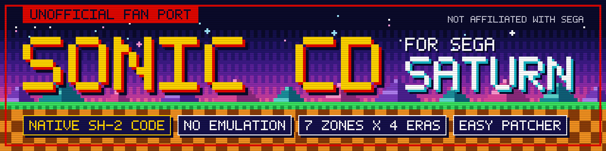

<p align="center">
  
</p>

# Sonic CD for Sega Saturn


A native Sega Saturn port of Sonic CD (1993). The game logic is reimplemented in C and runs on the Saturn's SH-2 CPUs. There is no Sega CD emulation. It follows the 1993 Sega CD release, not the 2011 remaster.

> [!IMPORTANT]
> This repository contains no SEGA art, audio, level data, program files, disc images or BIOS files, and no playable image will be distributed. The game logic is reimplemented in C; like the decompilation it follows, it keeps some of the original's numeric tables, and the test tools find code on your disc by short byte patterns. To build it you need your own U.S. and Japanese Sonic CD discs. Do not share the images you build. If you do not own the game, it is sold in [Sonic Origins](https://www.sega.com/games/sonic-origins).

<p align="center">
  
</p>

## Status

The current candidate is V0.082 (build label 2026-11-17). Its software regression finished on 2026-11-19: 215/215 checks, 347/347 matrix windows, and 70 art cases with zero misses. The tested game source is `49bfd89643b2a77962964a988e87b75a46e9b7a6`. My Saturn/SAROO test is pending. These counts do not establish a percentage of all paths through the game. See [V0.082 release notes](RELEASE-NOTES-V0.082.md) for the exact image hashes and evidence. Version history is in [CHANGELOG.md](CHANGELOG.md).

There is no release download yet. Two things come first: my console test of V0.082, and a public patcher that takes all game data from your own discs. Until then, the only way to get a playable image is to build it from source with your own discs (see [Building](#building)).

[`web/patcher`](web/patcher/README.md) holds the browser patcher's code only. It has no payload. The bundle I test it with contains converted game data, so it stays private and is not in this repository.

What works in the emulator:

- All 7 zones, each in 4 eras (Present, Past, Good Future, Bad Future), with time travel through time posts. 70 act/era variants in total.
- All seven bosses, Metal Sonic, Amy, and both endings.
- Special stages 1 to 8, entered from the big ring.
- Title screen, New Game, Continue, RAM Data and Time Attack.
- D.A. Garden, with its track list and looping music.
- Visual Mode: the opening, both endings and the pencil-test movie.
- The staff roll, the end screens, the "Thank You" screen and the Special Stage 8 credits. Each is compared with the original, picture by picture ([credits audit](docs/CREDITS-AUDIT.md)).
- Backup-RAM saves for progress, Time Stones and future flags. RESET is held off while a save is written, the two progress slots and the Time Attack record files are written in turn so a power cut keeps the previous save, and a slot that cannot be read is never overwritten (V0.080).
- The five secret sound-test pictures, from your disc (V0.080).
- The Japanese soundtrack, copied from your disc without resampling.
- An optional CD++-style preset (see below). Classic is the default.

The last build tested on hardware was V0.065 (2026-09-26), on my Saturn with a SAROO. It covered Palmtree Panic, Collision Chaos and Tidal Tempest, and the result was "works, no new defects". I did not log each act and era separately. Quartz Quadrant onward, the special stages, the front-end additions and the CD++ preset have never run on a console. V0.082 console acceptance remains open.

The zone table below is from the V0.080 full QA run.

| Zone | Retail match | Saturn routes | Art | Time travel | Campaign | Real Saturn |
| --- | --- | --- | --- | --- | --- | --- |
| Palmtree Panic | 10/10 | 10/10 | 10/10 | 10/10 | 3/3 | V0.065 ok; V0.080 pending |
| Collision Chaos | 10/10 | 10/10 | 10/10 | 10/10 | 5/5 | V0.065 ok; V0.080 pending |
| Tidal Tempest | 10/10 | 10/10 | 10/10 | 10/10 | 3/3 | V0.065 ok; V0.080 pending |
| Quartz Quadrant | 10/10 | 10/10 | 10/10 | 10/10 | 3/3 | never tested |
| Wacky Workbench | 10/10 | 10/10 | 10/10 | 10/10 | 3/3 | never tested |
| Stardust Speedway | 10/10 | 10/10 | 10/10 | 10/10 | 3/3 | never tested |
| Metallic Madness | 10/10 | 10/10 | 12/12 | 10/10 | 3/3 | never tested |

Each zone has 10 act/era variants: Acts 1 and 2 in four eras, Act 3 in both futures. "Retail match" replays a recorded controller route on the original Sega CD program and on the port, and compares nine state fields. "Campaign" plays from New Game through to the Good Future. All results are from the V0.080 BIN, SHA-256 `7bbce369…5338`. Evidence is in [RELEASE-NOTES-V0.080.md](RELEASE-NOTES-V0.080.md) and [QA-PLAN.md](QA-PLAN.md).

## CD++ preset

An optional preset adds five moves from the 2009 Sonic CD++ hack: the Sonic 2 spin dash, no air speed cap, an air roll, a homing attack and the mini Sonic spin dash. Switch it in RAM Data (MODE CLASSIC / CD++). The setting is saved in its own backup file, and Time Attack keeps separate CD++ records. The moves are written from scratch from public references. No CD++ code, patch data or sprites are used. Some values are this port's own choices, so it does not claim to match the hack frame for frame. Details are in [docs/CDPP-PRESET-SPEC.md](docs/CDPP-PRESET-SPEC.md).

## How this was checked

- Game logic follows the [Sonic CD C decompilation](https://github.com/nfroggy/soniccddecompilation) and is checked against [scddisasm](https://github.com/sonicretro/scddisasm), the disassembly of the Sega CD original. Where they disagree, the original wins.
- Retail match: the original Sega CD program runs in an offline emulator core with a recorded controller route. The Saturn build replays the same route in Beetle Saturn, and the two runs must agree on nine state fields. Each zone has 10 of these routes.
- Many objects, bosses, menus and movies are also compared picture by picture or state by state with the original. Examples: the credits audit, D.A. Garden, Visual Mode and the special stages.
- Player physics has its own trace test (`tools/test-player.sh`). The Classic traces must stay identical when the CD++ code is built in.
- The V0.080 full QA run has 201 steps and takes about 3.5 hours. All 201 passed, including 42 special-stage and front-end cases.
- None of this replaces a console test. Only a test on my own Saturn counts as "works on hardware". The last one was V0.065. V0.082 console acceptance remains open.

## Related project

orca_earth_md is making a separate Sonic CD port for the Saturn ([r/SegaSaturn post](https://www.reddit.com/r/SegaSaturn/comments/1wlryos/)). It was shown running on real hardware in September 2026. The two projects are independent. This one is a C reimplementation of the game logic that is tested against the original Sega CD program, and it is built only from your own discs.

## Known issues

- Lost rings can bounce one update apart from the original after the Sega CD lags. The port does not copy Sega CD slowdown ([lag note](docs/LAG-MODEL-NOTE.md)).
- Quartz Quadrant Act 1 Present: an era-sign timing difference reported in V0.078 is not reproduced on the current routes. It stays open until a route shows it or it is ruled out.
- Tidal Tempest Act 3 has no water-entry splash (it does not fit the sprite memory).
- Collision Chaos checks object touches in four passes where the original uses one loop that stops at the first overlap.
- Stardust Speedway special-stage jump headroom still needs a console check.

## Screenshots

V0.078 in Beetle Saturn, 2x nearest-neighbor. Console photos will follow the SAROO test.

| | |
| --- | --- |
|  |  |
|  |  |
|  | |

## Compatibility

| Target | State |
| --- | --- |
| Beetle Saturn (libretro) | All automated tests run here. V0.082 passes. |
| Real Saturn + [SAROO](https://github.com/tpunix/SAROO) | Main target. V0.065 works. V0.066 to V0.082 untested. |
| Mednafen | Used for manual play during development. |
| Yaba Sanshiro, Kronos, SSF | Untested. |
| Burned CD-R, other ODEs | Untested. |

The disc header lists every Saturn region (`IP_AREAS JTUBKAEL`), but only my console has run it. I did not record its model, region, video mode or SAROO firmware for the V0.065 test; that will be logged with the V0.082 test. PAL timing is untested.

The build produces one BIN/CUE with 42 tracks (one data track plus CD audio). Load the CUE. The ISO under `dist/iso/` has no music.

## Requirements

| Input | Path | Used for |
| --- | --- | --- |
| Sonic CD, U.S. disc, CHD | `assets/private/sonic-cd.chd` | Game programs, sound effects, Past music driver, demos, movies |
| Sonic CD, Japanese disc, CUE/BIN | `assets/private/sonic-cd-japan.cue` (symlink) | All 34 music tracks |
| U.S. Sega CD BIOS | `assets/private/bios_CD_U.bin` | Offline render of the Past music |
| U.S./EU Saturn BIOS | `assets/private/mpr-17933.bin` | Emulator tests only |

Two discs are needed because the port uses the Japanese soundtrack, while the game data and sound driver come from the U.S. disc. The tools are verified against one U.S. disc image; other U.S. revisions are untested. The Japanese disc is checked by its header and track layout. The build stops if a source is missing or does not match.

The build also downloads [scddisasm](https://github.com/sonicretro/scddisasm), the Sonic Retro disassembly, at a pinned commit. Stage art, layouts, palettes and mappings currently come from it. That repository contains SEGA-owned data and is not redistributed here. A later version will read these assets from your disc instead. See [THIRD-PARTY.md](THIRD-PARTY.md).

Do not post disc images, BIOS files, built images or links to them in issues or pull requests. They will be deleted.

## Building

Only tested on Apple Silicon macOS. Linux and Intel Macs have not been tried.

You need the Xcode command-line tools, Homebrew, Python 3.12+, Git, `ffmpeg` and `chdman` (`brew install ffmpeg rom-tools`), plus about 6 GB of disk space. The bootstrap script runs `brew install make xorriso gmp mpfr libmpc isl`, then builds a pinned toolchain (binutils 2.44, GCC 13.4.0 sh-elf, Yaul 0.3.1) inside the repo. It applies the fixes in `tools/patches/` to the pinned Yaul. Source revisions are pinned in [sources.lock.json](sources.lock.json).

```sh
git clone https://github.com/t3chnaztea/sonic-cd-saturn.git
cd sonic-cd-saturn

# Your own dumps (see Requirements)
mkdir -p assets/private
cp /path/to/your/sonic-cd-us.chd assets/private/sonic-cd.chd
cp /path/to/your/bios_CD_U.bin   assets/private/bios_CD_U.bin
ln -s "/path/to/Sonic the Hedgehog CD (Japan).cue" assets/private/sonic-cd-japan.cue
cp /path/to/your/mpr-17933.bin   assets/private/mpr-17933.bin   # emulator tests only

# Toolchain and pinned sources (--emulator also fetches Beetle Saturn for tests)
bash tools/bootstrap.sh --emulator

# Extract, convert and build the disc
bash tools/build.sh
```

This writes `dist/sonic-cd-saturn-prototype.cue` and its `.bin`. On an M-series Mac the toolchain build takes about 10 minutes and the first `tools/build.sh` about 20 minutes. The same source and discs give the same `.bin` from any checkout directory: ISO dates come from `IP_RELEASE_DATE` in the `Makefile` (or `SOURCE_DATE_EPOCH`), and no build path is compiled in. Everything stays in `.toolchain/`, `.deps/`, `build/` and `dist/`, all ignored by Git. Japanese disc setup is covered in [JAPANESE-MUSIC.md](JAPANESE-MUSIC.md).

To play on a Saturn, copy the `.bin` and `.cue` into a folder on the SAROO SD card and pick the game from the SAROO menu. To play in Mednafen with your Saturn BIOS, run `bash tools/run-emulator.sh`.

Tests:

```sh
python3 tools/qa-loop.py fast    # quick gates
python3 tools/qa-loop.py full    # every step (201 in V0.080), about 3.5 hours on my Mac
bash tools/test-player.sh        # player physics trace comparison
```

## Technical notes

Game logic is ported from the [Sonic CD C decompilation](https://github.com/nfroggy/soniccddecompilation) (CC0) and checked against scddisasm. Where they disagree, the Sega CD original wins.

VDP1 draws sprites and VDP2 draws terrain and parallax. Stage data is loaded from disc per act. Music is streamed as CD audio from the Japanese tracks. The Past music is rendered offline from the original Z80/PCM driver. Sound effects come from the original sound bank and play on the SCSP.

For testing, the original Sega CD program runs in an offline emulator core with recorded controller input, and the Saturn build replays the same input in Beetle Saturn. A test passes only when state and pixels match.

## Hardware reports

Console results are the most useful contribution. Use the [hardware test form](https://github.com/t3chnaztea/sonic-cd-saturn/issues/new?template=hardware_report.yml) and include the BIN SHA-256, Saturn model, region, video mode, SAROO firmware and what you saw. A photo or video helps. See [CONTRIBUTING.md](CONTRIBUTING.md).

## Credits

- [Sonic Retro](https://www.sonicretro.org/) and the [scddisasm](https://github.com/sonicretro/scddisasm) contributors, for the disassembly every behavior is checked against.
- [nfroggy and the Sonic CD C decompilation](https://github.com/nfroggy/soniccddecompilation) (CC0), the game-logic reference.
- [Yaul](https://github.com/yaul-org/libyaul) by Israel Jacquez and contributors (MIT), the Saturn SDK.
- [PoneSound](https://github.com/yaul-org/libyaul-examples) by ponut64 (MIT), the Saturn sound driver.
- [SAROO](https://github.com/tpunix/SAROO) by TPU, the optical drive emulator used for console tests.
- [Beetle Saturn](https://github.com/libretro/beetle-saturn-libretro) (Mednafen authors and libretro, GPL-2.0+) and [Genesis Plus GX](https://github.com/libretro/Genesis-Plus-GX) (Eke-Eke and contributors), used only for testing and audio rendering. Neither is linked into the game.
- qiuu and snkenjoi for [Sonic CD++](https://www.romhacking.net/hacks/1070/) (2009), with small spin dash sprites by MKAmeX, which inspired the CD++ preset. Christian Whitehead and SEGA for the 2011 remaster's spin dash option.
- Sonic Team and SEGA, for Sonic CD.

Full notices are in [THIRD-PARTY.md](THIRD-PARTY.md).

## AI use

This port was developed with heavy use of Claude Code (Anthropic's coding agent) under my direction. I set the goals, made the design decisions and run every console test. Each feature is checked against scddisasm with the trace and emulator tests in [QA-PLAN.md](QA-PLAN.md). Hardware results decide what counts as working.

## Legal

This is a non-profit fan project. It is not affiliated with or endorsed by SEGA or Sonic Team. Sonic the Hedgehog, Sonic CD and all related names, characters and marks belong to SEGA and are used here only to describe what this software works with. The repository contains no SEGA program files, graphics, music, sound or level data. The project does not accept donations.

## License

The port's own source code is under the [MIT License](LICENSE). It grants no rights to Sonic CD or any SEGA content. Third-party components keep their own licenses (see [THIRD-PARTY.md](THIRD-PARTY.md)). See also [CONTRIBUTING.md](CONTRIBUTING.md), the [Code of Conduct](CODE_OF_CONDUCT.md) and [SECURITY.md](SECURITY.md).
